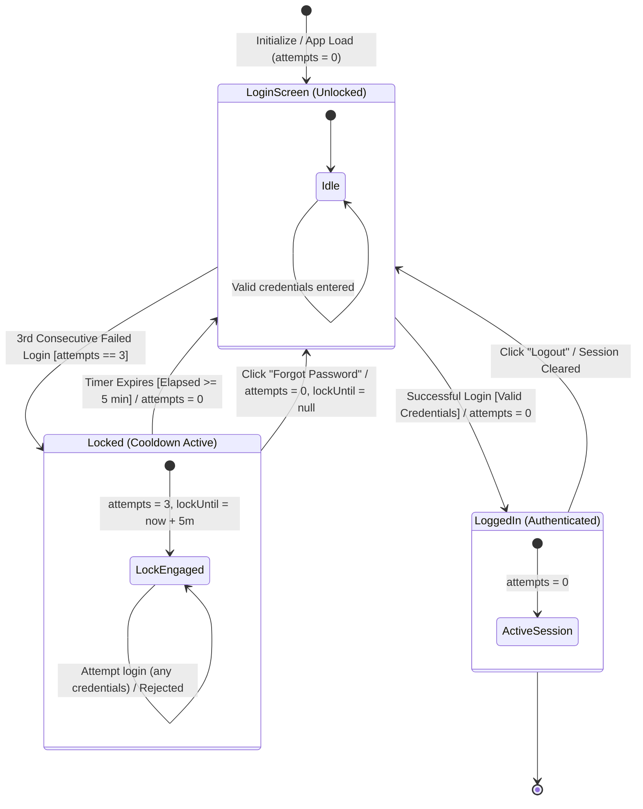

# Challenge 02 — Solution & QA Engineering Artifacts

This document contains the complete test analysis, structural models, test case specifications, and automation documentation for the **Login And Account Lockout** technical challenge.

---

## 1. System State Transition Model

The lifecycle of the authentication and lockout engine is modeled across three primary states (`LoginScreen`, `Locked`, and `LoggedIn`), mapping valid credentials, failed attempt thresholds, cooldown timer expiry, and recovery resets.



---

## 2. Test Design: Decision Tables

### Table 1: Authentication & Counter Transitions (Unlocked State)
Notation: T = True; F = False, * = Irrelevant; X = Action Executed; - = No Action

| Conditions scenarios                            | R01      | R02       | R03       | R04       | R05      |
| :---------------------------------------------- | :------- | :-------- | :-------- | :-------- | :------- |
| Account Status                                  | Unlocked | Unlocked  | Unlocked  | Unlocked  | Unlocked |
| Initial Counter Value                           | 0        | 0         | 1         | 2         | 2        |
| Password Input                                  | Correct  | Incorrect | Incorrect | Incorrect | Correct  |
| **<u>Actions</u>**                              |          |           |           |           |          |
| Login Succeeded                                 | X        | -         | -         | -         | X        |
| New Counter Value                               | 0        | 1         | 2         | 3         | 0        |
| Account Becomes Locked                          | -        | -         | -         | X         | -        |
| Message 'Login Success'                         | X        | -         | -         | -         | X        |
| Message: "Invalid Credentials"                  | -        | X         | X         | -         | -        |
| Message: "Invalid Credentials. User Locked Out" | -        | -         | -         | X         | -        |

---

### Table 2: Lockout State, Timer & Recovery
Notation: T = True; F = False, * = Irrelevant; X = Action Executed; - = No Action

| Conditions scenarios       | R06                                    | R07                      | R08            | R09                     |
| :------------------------- | :------------------------------------- | :----------------------- | :------------- | :---------------------- |
| Account State              | Locked                                 | Locked                   | Locked         | Logged In               |
| Trigger                    | Submit Password (Correct or Incorrect) | Submit "Forgot Password" | Wait 5 minutes | Log out while logged in |
| **<u>Actions</u>**         |                                        |                          |                |                         |
| Account Becomes Unlocked   | -                                      | X                        | X              | -                       |
| Counter Resets to 0        | -                                      | X                        | X              | -                       |
| Login Succeeded            | -                                      | -                        | -              | -                       |
| Message: "Account Locked"  | X                                      | -                        | -              | -                       |
| Message: "Password Resent" | -                                      | X                        | -              | -                       |
| Counter Untouched (0)      | -                                      | -                        | -              | X                       |
| Login Screen               | -                                      | -                        | X              | X                       |

---

## 3. Test Case Specification

| Id | Ref Rule | Description | Inputs | Expected Result |
| :---: | :---: | :--- | :--- | :--- |
| **TC01** | R01 | Successful Login With Correct Login and Correct Password | Precondition: Account unlocked, counter = 0<br>Action inputs: valid username, valid password | User logged in successfully; message displays 'Login Success'; counter is 0 |
| **TC02** | R02 | Failed Login With Correct Login and Incorrect Password | Precondition: Account unlocked, counter = 0<br>Action inputs: valid username, invalid password | Message displays 'Invalid Credentials'; user remains logged out; counter new value is 1 |
| **TC03** | R03 | Consecutive Failed Login With Correct Login and Incorrect Password | Precondition: Account unlocked, counter = 1<br>Action inputs: valid username, invalid password | Message displays 'Invalid Credentials'; user remains logged out; counter new value is 2 |
| **TC04** | R04 | 3 Consecutive Failed Login With Correct Login and Incorrect Password | Precondition: Account unlocked, counter = 2<br>Action inputs: valid username, invalid password | Account becomes locked; failed attempt counter updates to 3; 5-minute lockout timer initiates (lock timestamp recorded / cooldown active); message displays 'Invalid Credentials. User Locked Out' |
| **TC05** | R05 | Successful Login With Correct Login and Correct Password After 2 Incorrect Attempts | Precondition: Account unlocked, counter = 2<br>Action inputs: valid username, valid password | User logged in successfully; message displays 'Login Success'; counter is 0 |
| **TC06a** | R06 | Submitting Correct Password With Locked Account | Precondition: Account locked<br>Action inputs: valid username, valid password | Account remains locked; user remains logged out; message displays 'Invalid Credentials, Account locked out' |
| **TC06b** | R06 | Submitting Incorrect Password With Locked Account | Precondition: Account locked<br>Action inputs: valid username, invalid password | Account remains locked; user remains logged out; message displays 'Invalid Credentials, Account locked out' |
| **TC07** | R07 | Submitting Forgot Password | Precondition: Account locked<br>Action inputs: Click on "Forgot Password" button | Account becomes unlocked; counter resets to 0; message displays 'Password Resent'; Login Screen is displayed; active cooldown timer is cleared |
| **TC08** | R08 | Waiting 5 Minutes To Unlock Account | Precondition: Account locked<br>Action inputs: Wait 5 minutes (300,000 ms) for timer to expire | Account becomes unlocked; counter resets to 0; Login Screen is displayed |
| **TC09** | R09 | Logging Out While Logged In | Precondition: Account unlocked, user is logged in<br>Action inputs: Click on "Log Out" button | Counter remains untouched (0); user session ends; Login Screen is displayed |
| **TC10** | R06 | Timer Boundary: Attempting Login Just Before 5 Minutes (e.g. 4m 59s) | Precondition: Account locked, cooldown active<br>Action inputs: 4m 59s (299,000 ms) elapsed; submit valid credentials | Account remains locked; login rejected; message displays 'Invalid Credentials, Account locked out' |
| **TC11** | R08 | End-to-End Recovery Flow: Successful Login After 5-Minute Timer Expiry | Precondition: Account was locked; 5 minutes elapsed (auto-unlocked, counter reset to 0)<br>Action inputs: Submit valid username and valid password | Login succeeds; status: 'LoggedIn'; message displays 'Login Success'; counter remains 0 |
| **TC12** | R07 | End-to-End Recovery Flow: Successful Login After "Forgot Password" | Precondition: Account was locked; clicked "Forgot Password" (unlocked, counter reset to 0)<br>Action inputs: Submit valid credentials | Login succeeds; status: 'LoggedIn'; message displays 'Login Success'; counter remains 0 |
| **TC13** | R02 | Input Validation / Error State: Empty Password Field | Precondition: Account unlocked, counter = 0<br>Action inputs: Valid username, empty password ("") | Submission blocked; message displays 'Invalid Credentials'; counter updates to 1 |
| **TC14** | R02 | Input Validation / Error State: Empty Username / Non-Existent User | Precondition: On login screen<br>Action inputs: Empty username ("") or unknown user, any password | Submission blocked; message displays 'Invalid Credentials' |
| **TC15** | R02 | Edge Case: Password Case Sensitivity | Precondition: Account unlocked, counter = 0<br>Action inputs: Valid username, incorrect case password | Login rejected; message displays 'Invalid Credentials'; counter increments to 1 |

---

## 4. Automated Test Suite

The test cases specified above are automated using **Cypress E2E** to evaluate the login and lockout implementation directly against the browser DOM.

- **Test Spec File:** [`cypress/e2e/login.cy.js`](./cypress/e2e/login.cy.js)
- **Custom Cypress Commands:** [`cypress/support/commands.js`](./cypress/support/commands.js) (`cy.attemptLogin`, `cy.assertLoginState`)
- **SUT Web App:** [`login.html`](./login.html) & [`login.js`](./login.js)

### Running the Tests Locally

1. **Install dependencies:**
   ```bash
   # Option A: If cloning the repo with an existing package.json
    npm install

    # Option B: Complete explicit install commands (from scratch)
    npm init -y
    npm install --save-dev cypress
   ```

2. **Start the local server:**
   ```bash
   npx http-server -p 8080
   ```

3. **Run tests via Cypress:**
   ```bash
   # Option A: Run all 15 tests headlessly
    npx cypress run --spec "cypress/e2e/login.cy.js"

    # Option B: Open interactive runner GUI
    npx cypress open
   ```
---

### Test Case to Implementation Traceability

| Test id | Test name in login cy js                                                                   | Ref rule | Status | Notes defect reference                                           |
| :------ | :----------------------------------------------------------------------------------------- | :------- | :----- | :--------------------------------------------------------------- |
| TC01    | TC01 - Successful Login With Correct Login and Correct Password                            | R01      | PASS   | Baseline valid login verified                                    |
| TC02    | TC02 - Failed Login With Correct Login and Incorrect Password                              | R02      | PASS   | First failed attempt increments counter to 1                     |
| TC03    | TC03 - Consecutive Failed Login With Correct Login and Incorrect Password                  | R03      | PASS   | Second failed attempt increments counter to 2                    |
| TC04    | TC04 - 3 Consecutive Failed Login With Correct Login and Incorrect Password                | R04      | FAIL   | Exposes BUG-01 (Lockout bypassed by valid credentials)           |
| TC05    | TC05 - Successful Login With Correct Login and Correct Password After 2 Incorrect Attempts | R05      | FAIL   | Exposes BUG-02 (Counter fails to reset to 0 upon login)          |
| TC06a   | TC06a - Submitting Correct Password With Locked Account                                    | R06      | FAIL   | Exposes BUG-01 (Lockout guard precedence failure)                |
| TC06b   | TC06b - Submitting Incorrect Password With Locked Account                                  | R06      | FAIL   | Exposes BUG-01 / BUG-04 (State corruption while locked)          |
| TC07    | TC07 - Submitting Forgot Password                                                          | R07      | FAIL   | Exposes BUG-03 (Forgot Password fails to unlock / reset counter) |
| TC08    | TC08 - Waiting 5 Minutes To Unlock Account                                                 | R08      | FAIL   | Exposes BUG-04 (5-minute cooldown timer fails to auto-unlock)    |
| TC09    | TC09 - Logging Out While Logged In                                                         | R09      | PASS   | Logout returns to LoginScreen successfully                       |
| TC10    | TC10 - Timer Boundary: Attempting Login Just Before 5 Minutes                              | R06, R08 | FAIL   | Exposes BUG-01 / BUG-04 (Cooldown boundary breach)               |
| TC11    | TC11 - End-to-End Recovery Flow: Successful Login After 5-Minute Timer Expiry              | R08, R05 | FAIL   | Exposes BUG-02 / BUG-04 (Timer expiry and counter reset)         |
| TC12    | TC12 - End-to-End Recovery Flow: Successful Login After Forgot Password Flow               | R07, R05 | FAIL   | Exposes BUG-02 / BUG-03 (Recovery unlock and counter reset)      |
| TC13    | TC13 - Input Validation: Empty Password                                                    | R02      | PASS   | Empty password properly rejected                                 |
| TC14    | TC14 - Input Validation: Empty Username                                                    | R02      | PASS   | Empty username properly rejected                                 |
| TC15    | TC15 - Input Validation: Password Case Sensitivity                                         | R02      | PASS   | Case sensitivity enforced                                        |

---

## 5. Defect Summary

The 11 test failures above map to 4 root-cause defects in the SUT. Detailed bug reports with preconditions, execution steps, expected vs. actual outcomes, and root-cause analyses are documented in:   👉 **[View Defect Reports (BUG_REPORTS.md)](./docs/BUG_REPORTS.md)**